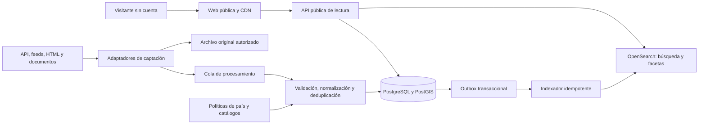

# GeoEmpleo: análisis funcional y propuesta de arquitectura

Fecha: 14 de octubre de 2026, Europe/Madrid. Estado: arquitectura propuesta, con una primera biblioteca local de dominio implementada. El resto de la plataforma permanece sin implementar. Acceso sin registro y visualización mediante Google Maps son requisitos confirmados del usuario.

## 1. Referencia funcional y límites de ingeniería inversa

La revisión combina la página pública y navegación real sin autenticación. Se inspeccionaron listado, detalle, mapa y controles de ordenación/salario. No se accedió a sistemas privados ni se ejecutaron cargas contra Bandana.

### Observaciones verificadas

En [Bandana Search](https://bandana.com/search) se observaron:

| Elemento | Comportamiento observado |
|---|---|
| Consulta | Texto por puesto/empresa y localización |
| Resultados | Listado paginado, salario, empresa, zona y etiquetas |
| Ordenación | Relevancia, fecha y salario ascendente/descendente |
| Filtros | Modalidad, salario, sector, experiencia, jornada, formación, remuneración, beneficios y metro |
| Salario | Mínimo/máximo por hora y selección de ofertas con remuneración informada |
| Mapa | Marcadores agrupados y búsqueda al desplazarlo; excluye ofertas sin ubicación |
| Detalle | Panel con descripción, requisitos, beneficios, dirección, actualización y acción de candidatura |
| Descubrimiento | Colecciones, sectores y ubicaciones enlazados |
| Acceso | Se abrió una oferta de Macy’s sin cuenta; las indicaciones de desplazamiento solicitaban cuenta |

El contador visible es una afirmación del producto, no una auditoría. La atribución cartográfica corresponde a Google. El DOM incluye scripts `/_next/static/` y `__NEXT_DATA__`, señales de Next.js con alta confianza. No se verificaron versiones, todo el catálogo ni la candidatura.

### Qué puede y qué no puede deducirse

La interacción sugiere un catálogo enriquecido con consulta geográfica y metadatos normalizados. Es una inferencia funcional. Las señales del frontend **no prueban** qué backend, base de datos, motor de búsqueda o infraestructura usa Bandana, ni su estrategia de renderizado completa. Tampoco prueban sus fuentes, frecuencia de captación, algoritmo de ranking o reglas de verificación.

La equivalencia propuesta reproduce necesidades de producto —buscar trabajo por ubicación y condiciones— mediante arquitectura propia. No depende de endpoints internos de Bandana ni de copiar su contenido, marca o recursos.

## 2. Producto para España, totalmente público

Recorrido principal: escribir puesto y municipio/CP → aplicar filtros → alternar listado/mapa → consultar ficha completa → abrir la vía oficial de inscripción.

Todas las pantallas de consulta serán accesibles sin cuenta, token de candidato, correo ni cookie de sesión. No habrá registro opcional, perfiles, CV almacenados, autenticación social, alertas que exijan cuenta ni personalización basada en identidad. No habrá límites de detalle reservados a usuarios registrados.

El destino externo de inscripción puede imponer requisitos propios. Mostrar antes del salto el nombre del destino y si exige registro (`required`, `not_required`, `unknown`). Permitir filtrar por vías de candidatura sin registro cuando ese dato esté comprobado; si es desconocido, indicarlo. No prometer candidatura universal sin registro.

### Adaptación regional

| Dimensión | Diseño para España |
|---|---|
| Ubicación | País, comunidad/ciudad autónoma, provincia cuando corresponda, municipio, CP y radio en km |
| Salario | EUR; bruto, periodo, rango, jornada, horas y número de pagas si están publicados |
| Contrato | Indefinido, temporal, fijo discontinuo, formación u otros mediante catálogo regional versionado |
| Jornada | Completa/parcial, horas semanales, turnos, nocturno, fines de semana; distinto del contrato |
| Perfiles | Ocupación, sector, experiencia, formación y responsabilidad como ejes independientes |
| Empleo rural | Municipio, clasificación territorial con origen/versión y requisitos de movilidad; alojamiento solo si está declarado |
| Empleo público | Diferenciar vacante, convocatoria y bolsa; organismo, bases, plazas, proceso y plazo |
| Idiomas | Interfaz `es-ES`; conservar original y ofrecer traducción identificada si procede |

España incluye Ceuta, Melilla y Canarias. La zona horaria debe pertenecer al territorio: no tratar toda España como `Europe/Madrid`. Los plazos se almacenan en UTC con zona y precisión originales; una fecha sin hora no se convierte silenciosamente en una hora exacta.

El catálogo territorial es un árbol, no una estructura rígida de tres niveles. Los códigos oficiales y su actualización se validarán antes de importarlos. El CP no identifica inequívocamente un municipio. Las ofertas remotas incluyen países/territorios desde los que se permite trabajar.

Las páginas de detalle tendrán URL permanente y contenido renderizado en servidor. Diseño mobile first, navegación por teclado, contraste y alternativa textual al mapa. La lista conservará las ofertas sin coordenadas; el mapa informará cuántas no puede representar.

## 3. Arquitectura y alternativas

| Alternativa | Ventajas | Costes y encaje |
|---|---|---|
| **API modular + workers separados + buscador dedicado** | Límites claros, escala independiente, menor complejidad operativa | Recomendada para el lanzamiento nacional solicitado |
| Aplicación única con búsqueda en PostgreSQL | Operación sencilla, menos infraestructura | Útil para piloto; necesita demostrar que facetas/mapa/carga nacional cumplen objetivos |
| Microservicios completos desde el inicio | Autonomía por equipo y despliegue | Más contratos distribuidos, coordinación y operación; reservar para necesidades demostradas |

### Componentes propuestos

| Componente | Tecnología sugerida | Contrato/responsabilidad |
|---|---|---|
| Web pública | Next.js/React + TypeScript | SSR de detalle y páginas editoriales; interacción cliente para filtros y mapa |
| Mapa público | Google Maps JavaScript API | Visualización elegida por el usuario; componente cliente aislado, marcadores y agrupaciones del catálogo propio |
| API pública | NestJS + TypeScript | OpenAPI, validación, búsqueda, detalle y catálogo; exclusivamente lectura pública |
| Catálogo | PostgreSQL + PostGIS | Vacantes, publicaciones, procedencia, geografía y outbox transaccional |
| Motor de consulta | OpenSearch administrado | Texto, facetas, ordenación y filtros geográficos sobre proyección denormalizada |
| Captación | Python/Scrapy | Adaptadores API, feed, HTML y documentos |
| Normalización | Worker TypeScript independiente | Consume eventos JSON validados y reutiliza políticas de país del dominio; contratos y fixtures compartidos con Python |
| Navegador de captación | Playwright en workers aislados | Solo fuentes autorizadas que requieran renderizado; no camino por defecto |
| Tareas | Cola administrada con DLQ, p. ej. SQS | Entrega al menos una vez, reintentos y control de concurrencia por fuente |
| Archivo | Objetos compatibles con S3 | Capturas autorizadas, hashes, versiones y retención configurable |
| Distribución | CDN/WAF y caché limitada | Contenido público y protección contra abuso; Redis si las mediciones lo justifican |
| Observabilidad | OpenTelemetry + métricas/logs | Latencia, frescura, calidad, costes y trazabilidad por fuente |

Utilizar contenedores administrados e infraestructura como código. Elegir servicios equivalentes según proveedor y equipo; mantener contratos propios para no acoplar el dominio a un cloud. PostgreSQL/OpenSearch/cola requieren operación gestionada o capacidad interna explícita. Las versiones y compatibilidades se fijarán en una prueba técnica antes de implementar.

Los scrapers no reciben tráfico de usuarios. La API no consulta portales externos durante una búsqueda. El frontend no accede directamente a OpenSearch ni conoce secretos de proveedores. La gestión operativa es privada y separada de la experiencia pública; usa identidades técnicas/operativas, sin crear cuentas de candidatos.

## 4. Modularidad multi-país y extensiones

Módulos de dominio: `catalog`, `sources`, `ingestion`, `geography`, `taxonomy`, `compensation`, `search` y `publication-policy`. Se comunican mediante interfaces y eventos versionados, no mediante tablas compartidas sin contrato.

| Punto de extensión | Contrato conceptual |
|---|---|
| `SourceConnector` | `capabilities`, `fetchBatch(cursor)`, `parse(record)`, `health`; devuelve registros de origen |
| `CountryPolicy` | Normaliza contrato/salario/plazos; valida reglas del país y atributos regionales |
| `Geocoder` | Ubicación textual → candidatos, precisión y confianza; no inventa dirección |
| `TaxonomyMapper` | Etiquetas de fuente → conceptos canónicos y equivalencias regionales versionadas |
| `SearchRepository` | Consulta tipada → resultados/facetas/cursor; oculta el proveedor de búsqueda |
| `PublicationPolicy` | Decide qué campos/contenido pueden mostrarse y cuánto tiempo conservarse |

Un paquete de país contiene configuración, catálogos, traducciones, normalizadores y pruebas. `country_code` identifica una política registrada; no debe conducir a una cadena de `if country == ...` en el núcleo. Las variaciones subnacionales se resuelven mediante políticas regionales del paquete.

Añadir un país: registrar paquete → importar territorio/taxonomía → habilitar fuentes autorizadas → construir índices y analizadores → ejecutar contratos → activar rutas. No requiere editar la lógica base para reglas soportadas por los contratos existentes. Una capacidad de producto realmente nueva puede exigir evolución compatible del contrato; no se promete extensibilidad ilimitada sin cambios.

Añadir una fuente: adaptador + configuración + mapa de campos + política de publicación + fixtures y métricas. JSONB queda reservado para extensiones con esquema/versionado; país, fechas, salario y filtros frecuentes son campos tipados.

## 5. Modelo de datos modular

### Entidades y relaciones

| Entidad | Campos esenciales y relaciones |
|---|---|
| `Country` | Código ISO, locales, moneda predeterminada, versión de política y estado |
| `Region` | País, tipo de división, `parent_id`, códigos oficiales, zona horaria, geometría y vigencia |
| `Source` | Editor, tipo, dominios permitidos, modo de integración, cuotas, calendario y estado |
| `SourceCoverage` | Relación fuente-país/territorio; una fuente puede servir a varios países |
| `SourcePolicy` | Condiciones/licencia, atribución, permiso de detalle completo, campos permitidos, retención y revisión |
| `Employer` | Identificador interno, nombre, aliases, dominio y referencias externas verificadas |
| `Vacancy` | UUID, mercado principal/país de política, tipo de oportunidad, título, descripción completa autorizada, empresa, contrato, jornada, modalidad, experiencia, formación, responsabilidad, fechas, estado y versión |
| `SourcePosting` | Fuente, identificador externo, URL, vacante, hash, primera/última observación, última comprobación satisfactoria y estado |
| `PostingRevision` | Versión original, referencia al objeto archivado, versión del parser y momento de captura |
| `VacancyLocation` | País/territorio, dirección, punto, precisión, confianza y fuente del dato; N ubicaciones por vacante |
| `RemoteEligibility` | Modalidad y países/regiones admisibles; zona horaria requerida si se declara |
| `Compensation` | Rango, moneda, bruto/neto/desconocido, periodo, pagas, horas, fijo/variable y evidencia |
| `OccupationConcept` | Sistema, código/URI, versión, labels y relaciones jerárquicas |
| `VacancyClassification` | Ocupación/sector/skills, confianza, método y evidencia; permite varias clasificaciones |
| `TaxonomyMapping` | Sistema y versión de origen/destino; relación exacta/amplia/estrecha, sin asumir equivalencia 1:1 |
| `PublicOpportunity` | Organismo, bases, plazas, tipo de proceso, requisitos, plazos y publicaciones oficiales |
| `ApplicationRoute` | URL/contacto institucional autorizado, tipo de canal y requisito de registro externo comprobado |
| `FieldProvenance` | Campo, publicación/revisión de origen, extracción, confianza y transformación aplicada |
| `IngestionRun` | Fuente, cursor, modo snapshot/incremental, cobertura, versión y estado de reconciliación |
| `OutboxEvent` | Entidad, versión, tipo de evento, fecha y estado de entrega |

`Vacancy` 1:N `SourcePosting`; `Source` 1:N `SourcePosting`; `Vacancy` 1:N ubicaciones, remuneraciones y vías de candidatura. Una publicación puede existir en staging sin vacante publicada. Restricción única `(source_id, external_id)` cuando el ID es estable; URLs canónicas y hashes son alternativas controladas cuando no lo es.

Contrato, jornada, experiencia, formación y responsabilidad referencian catálogos tipados; permiten valor desconocido, código regional y versión. Registrar la versión de política aplicada a cada normalización. El mercado principal determina las reglas de publicación; no equivale a los territorios admisibles para trabajar en remoto.

Un anuncio con diez plazas sigue siendo un anuncio con `positions_count=10`, no diez resultados duplicados. Una convocatoria con puestos heterogéneos puede agrupar subofertas vinculadas cuando las bases permiten identificarlas. Una bolsa abierta no se etiqueta como vacante inmediata. Conservar el contexto oficial y no inferir plazos desde la fecha del anuncio.

### Clasificación inclusiva

Separar ocupación, industria, cualificación, experiencia, responsabilidad y formación. Un operario especializado puede tener mucha experiencia; un profesional titulado puede ser principiante. No equiparar «sin titulación» con «sin experiencia».

Proponer ESCO como vocabulario interoperable y mapear CNO de España con versiones y revisión de correspondencias. La Comisión proporciona servicios para acceder a la clasificación; se importarán catálogos versionados para evitar dependencia de la API durante las búsquedas. [Documentación ESCO](https://esco.ec.europa.eu/en/use-esco/use-esco-services-api).

Las familias de navegación deberán cubrir agricultura, cuidados, limpieza, hostelería, comercio, logística, industria/oficios, administración, sanidad, educación, tecnología, ingeniería, finanzas, profesiones especializadas y dirección. Son agrupaciones de producto sobre conceptos, no un listado cerrado de puestos.

Los extractores automáticos pueden ayudar a clasificar, pero deben conservar evidencia y confianza. Su salida pasa validación de esquema; no puede inventar salario, requisitos, empresa ni ubicación. Los casos ambiguos quedan desconocidos o se revisan.

### Salario: regla crítica

Conservar siempre el dato original. El anual equivalente solo existe si pueden justificarse periodo, pagas y horas: salario mensual × pagas; por hora × horas semanales × semanas remuneradas únicamente cuando todas están disponibles y la regla es aplicable. Registrar fórmula, hipótesis, versión y confianza. No imponer 14 pagas ni 40 horas a todas las ofertas. No convertir neto a bruto automáticamente.

Filtrar/ordenar por importe y base comparable. Cuando no sea comparable, ofrecer su periodo original y excluirlo del filtro normalizado con explicación. El filtro de mínimo significará «mínimo garantizado declarado ≥ umbral», no «el máximo anunciado alcanza el umbral». Los salarios ausentes permanecen accesibles mediante opción explícita.

## 6. Estrategia de agregación para España

La prioridad es disponer de ofertas completas, vigentes y publicables. Una API visible o un sitio público no acredita por sí mismo derecho a reproducir descripciones, datos personales o imágenes. El inventario de fuentes registra por separado posibilidad de captación y permiso de publicación.

| Familia | Evidencia / candidatas | Integración prevista y condición |
|---|---|---|
| Estatal | SEPE / Empléate, portal confirmado | Solicitar canal autorizado de extracción o colaboración; no asumir API abierta |
| Empleo público | API de datos abiertos del BOE confirmada | Consumir sumarios y documentos pertinentes; extraer convocatorias, no tratar la API como feed de vacantes completo |
| Autonómica/local | Servicios de empleo, boletines y bolsas municipales | Inventario por territorio, feed/API si existe; HTML/documentos permitidos como alternativa; acceso sin verificar individualmente |
| Rural | Volver al Pueblo de COCEDER, plataforma confirmada | Proponer acuerdo/feed; API, permiso de réplica y detalle completo aún sin confirmar |
| Portal privado | Documentación de InfoJobs confirmada | API con credenciales de aplicación y autorización de uso; cuotas y derechos de réplica pendientes |
| Otros agregadores/portales | Candidatas por inventariar y priorizar | Acuerdo/API/feed antes de scraping; no presumir APIs abiertas ni acceso a plataformas restringidas |
| Empresas/ATS | Páginas corporativas y feeds autorizados | JSON-LD `JobPosting`, API de ATS o HTML cuando esté permitido |

Empléate agrega empleo del sistema público y otros portales. Su documentación describe XML/JSON/RSS para **publicar en Empléate**, no confirma descarga masiva de su inventario. [SEPE, explicación e integración](https://www.sepe.es/HomeSepe/es/que-es-el-sepe/comunicacion-institucional/publicaciones/publicaciones-oficiales/listado-pub-empleo/empleate.html).

InfoJobs documenta `GET /offer` y `GET /offer/{offerId}` y requiere credenciales de aplicación. No se ha probado una petición autenticada ni asegurado autorización para republicar. No usar operaciones de perfiles o candidaturas autenticadas. [Documentación InfoJobs](https://developer.infojobs.net/documentation/operation-list/index.xhtml).

El BOE publica una API de sumarios y otros conjuntos jurídicos; la extracción de empleo requiere interpretación y seguimiento de bases. [Catálogo de datos abiertos](https://www.boe.es/datosabiertos/). COCEDER muestra recursos de empleo rural; eso acredita su relevancia como candidata, no un canal de integración. [Volver al Pueblo](https://volveralpueblo.coceder.org/).

Para cada fuente: revisión de condiciones/licencia, mecanismo de acceso, frecuencia máxima, derechos de texto/logo, atribución, datos de contacto, caducidad, cobertura y proceso de retirada. `robots.txt` es una señal operativa que debe respetarse; no sustituye la evaluación del permiso de reutilización. El BOE establece condiciones específicas y obligaciones sobre datos personales. [Condiciones de reutilización del BOE](https://www.boe.es/informacion/aviso_legal/index.php#reutilizacion).

Fuentes sin autorización de detalle completo quedan fuera del catálogo que promete esa función hasta resolver el permiso. Mantenerlas como candidatas de integración, sin fingir cobertura mediante fichas parciales. Nunca reconstruir contenido oculto tras login ni sortear barreras de acceso.

## 7. Flujo de datos y fiabilidad

1. **Planificación:** scheduler consulta políticas y salud; crea tareas por fuente/cobertura y cursor. Limita concurrencia por dominio y cuota; evita ejecuciones solapadas del mismo cursor.
2. **Captación:** API/feed primero, después HTML estructurado; renderizado y PDF/OCR como último recurso autorizado. Timeouts, tamaño máximo, identificación del cliente, `Retry-After`, backoff con jitter y circuito de suspensión.
3. **Evidencia:** archivar solo contenido permitido, con hash, URL, hora, licencia/política y versión del parser. Retención por fuente; no almacenar indefinidamente datos personales incidentales.
4. **Validación:** comprobar contrato de origen, integridad y contenido completo. Separar errores de formato, cambios de esquema y datos ausentes. Enviar anomalías a cuarentena, sin afectar al catálogo válido.
5. **Normalización:** textos/HTML saneado, fechas, contratos, salario, empresa, territorio y taxonomía usando paquetes de país. Si hay traducción, preservar original, marcarla y revisar campos sensibles.
6. **Geocodificación:** resolver municipio antes que dirección; guardar precisión y confianza. Casos ambiguos no reciben coordenadas exactas. Reusar resultados y respetar licencia del geocodificador.
7. **Deduplicación:** IDs/URLs de origen → candidatos por empresa, puesto, territorio y fechas → comparación textual y umbrales conservadores. No fusionar puestos distintos solo por títulos parecidos. Registrar decisiones reversibles y conservar todas las publicaciones/vías.
8. **Persistencia:** upsert idempotente de publicación y versión canónica, más evento outbox en la misma transacción. La procedencia de cada campo determina qué versión prevalece y explica discrepancias entre fuentes.
9. **Indexación:** consumidores aplican eventos por versión de entidad; ignorar versiones antiguas. Batches, reintentos y DLQ. Proyección con mappings explícitos; alias permite reconstrucción y cambio de versión del índice sin interrupción.
10. **Reconciliación:** comprobar vigencia y enlaces según SLA de fuente. Una ejecución fallida o incompleta no cierra ofertas. La ausencia solo permite retirada tras snapshot completo de cobertura conocida y periodo de gracia; los incrementales requieren tombstone o comprobación explícita.
11. **Retirada:** cerrar por confirmación/plazo fiable; invalidar caché y proyección. Una vacante canónica permanece activa si otra publicación vigente la sostiene, salvo caducidad explícita del propio puesto.

Separar `published_at`, `first_seen_at`, `last_seen_at`, `last_successfully_checked_at`, `updated_at` y `expires_at`. Reingestar una oferta no la convierte en recién publicada. Una fuente caída reduce confianza en su vigencia; no demuestra ni cierre ni renovación.

Reprocesar desde evidencia cuando cambie parser o taxonomía, sujeto a retención autorizada. Claves idempotentes, outbox y control de versiones ofrecen recuperación sobre entrega al menos una vez; no prometer entrega distribuida exactamente una vez.

## 8. Búsqueda y filtrado rápido

### Índice y ranking

Un documento de búsqueda por vacante canónica, con campos de tarjeta, ocupaciones, territorios, estado, fechas, compensación comparable, modalidad y coordenadas. No duplicar documentos por cada portal. Las ubicaciones múltiples admiten filtros anidados que evitan combinar municipio de una ubicación con país de otra.

Separar campos de texto analizado y keywords para filtros. Analizador español con normalización de mayúsculas/acentos, diccionarios de sinónimos curados y tratamiento apropiado de nombres técnicos. Título/ocupación tienen mayor peso que descripción; empresa es campo específico. Autocomplete de puestos y territorio en índices/campos dedicados y con mínimo de caracteres.

Ranking inicial: coincidencia textual y ocupacional, proximidad cuando se solicite, frescura real, calidad y vigencia comprobada. No requiere identidad ni historial. Medir cobertura rural y por familia profesional para evitar un sesgo exclusivo hacia grandes ciudades o puestos con salarios informados.

Las promociones, si se incorporan en el futuro, llevarán etiqueta explícita y política separada; no forman parte del alcance confirmado. No puntuar candidatos ni almacenar perfiles personales.

### Semántica de filtros

AND entre dimensiones; OR entre valores elegidos en una dimensión. Facetas calculadas sobre el mismo país, estado y permisos que los resultados. Para permitir añadir valores, los conteos de una faceta omiten solo su propio filtro y conservan los demás; documentar esa semántica para QA.

Filtros principales: palabra/empresa, territorio/radio, remoto y elegibilidad territorial, ocupación/sector, salario/periodo, contrato, jornada/turnos, experiencia, formación, fecha, empleo público, origen y registro externo requerido. Campos desconocidos son categorías explícitas; no representan ausencia del requisito.

Separar dos modos geográficos: área visible del mapa y ubicación/radio. Un cambio de mapa no debe sobreescribir silenciosamente el radio; mostrar el ámbito activo. Para remoto, explicar si los resultados siguen elegibilidad territorial en lugar de distancia física.

### Rendimiento y API pública

| Ruta propuesta | Resultado |
|---|---|
| `GET /v1/{country}/jobs` | Tarjetas, facetas, ámbito aplicado y cursor |
| `GET /v1/{country}/jobs/{id}` | Detalle completo público, procedencia y vías de inscripción |
| `GET /v1/{country}/map` | Clusters/markers limitados por bbox, zoom y filtros |
| `GET /v1/{country}/locations/suggest` | Territorios desambiguados y precisión |
| `GET /v1/{country}/occupations/suggest` | Ocupaciones y aliases en español |
| `GET /v1/{country}/filters` | Catálogos y capacidades de país |

Validar país registrado, valores, bbox, radio y límites de tamaño; impedir consultas arbitrarias al motor. La misma query normalizada alimenta lista y mapa. El mapa devuelve agrupaciones por zoom, nunca todo el inventario nacional en una respuesta.

Debounce de 250–400 ms para entradas/mapa, cancelación de solicitudes obsoletas y aplicación explícita de filtros en móvil. Cargar el mapa bajo demanda y limitar atributos en tarjetas.

Para paginación profunda: cursor opaco firmado, `search_after` + PIT con TTL corto y límite de contextos; orden estable con ID como desempate. El cursor incluye fingerprint de filtros/país/orden y versión del índice. Si expira, informar y reiniciar; no mezclar páginas de consultas distintas. Esta estrategia responde a las limitaciones documentadas de paginación por offset. [OpenSearch: paginación](https://docs.opensearch.org/latest/search-plugins/searching-data/paginate/).

Las cachés incluyen país, locale, query, filtros, orden, ámbito y generación del catálogo; TTL corto más invalidación para cierres. Consultas y coordenadas precisas no se conservan en logs generales. Respuesta de detalle valida estado canónico. Al consultar un PIT antiguo, la API descarta candidatos cerrados según el catálogo vigente y repone la página cuando sea posible; caducidad explícita se filtra también con la hora actual. Publicar el desfase máximo aceptado del índice.

Si el motor falla, mantener detalle disponible y mostrar indisponibilidad temporal en la búsqueda; no emitir cero resultados como si el catálogo estuviera vacío. Una alternativa PostgreSQL solo se habilita si está implementada y probada para un subconjunto de filtros.

SEO: páginas editoriales/locales con contenido útil y URLs canónicas; no indexar todas las combinaciones de filtros. JSON-LD `JobPosting` solo cuando el tipo de oportunidad y contenido cumplen los requisitos de publicación, con retirada/actualización al caducar. No etiquetar automáticamente una bolsa como vacante.

### Google Maps: decisión confirmada

Usar Maps JavaScript API para el mapa y mantener sus objetos dentro de un adaptador de UI. El backend devuelve coordenadas y agrupaciones propias; los filtros y el dominio no dependen de clases de Google. Cargar el SDK una vez bajo demanda, configurar español/región España y conservar atribución y controles accesibles. Fallos del SDK no bloquearán listado ni detalle.

Maps JavaScript API requiere facturación y credenciales técnicas; otros servicios se facturan por separado. Planificar cargas, cuotas y alertas; una alerta de presupuesto no es un corte automático de gasto. No se han activado servicios ni contratado capacidad. [Uso y facturación](https://developers.google.com/maps/documentation/javascript/usage-and-billing).

La clave de navegador es visible: restringirla por sitios autorizados y APIs necesarias, separar entornos y claves de servidor. No usar una clave backend en el bundle público. [Seguridad de Google Maps](https://developers.google.com/maps/api-security-best-practices).

Google Maps para visualizar no exige usar Google para geocodificar. Priorizar coordenadas de fuentes con derechos de almacenamiento/indexación. No guardar respuestas de Geocoding/Places como catálogo permanente sin comprobar el permiso; hay restricciones de almacenamiento y condiciones específicas para direcciones de facturación del EEE. [Políticas de Geocoding](https://developers.google.com/maps/documentation/geocoding/policies). Incorporar términos/privacidad públicos y mantener atribuciones conforme a [políticas de Maps JavaScript](https://developers.google.com/maps/documentation/javascript/policies).

Places, Geocoding y Routes quedan fuera de la integración inicial del mapa; se evaluarán por necesidad y condiciones. El autocompletado inicial consulta el catálogo territorial propio. No habrá registro de candidatos ni requisito de cuenta Google para usar GeoEmpleo.

## 9. Escala, objetivos y operación

Hipótesis de diseño para pruebas, pendiente de validación de negocio y presupuesto:

| Variable | Escenario de referencia |
|---|---|
| Inventario | 1 millón de ofertas canónicas activas |
| Historial | 5 millones de publicaciones/revisiones en el conjunto de prueba |
| Consulta | 500 solicitudes/s sostenidas; ráfagas de 1.500/s durante 10 minutos, sumando lista, facetas, mapa y sugerencias |
| Ingesta | Hasta 2 millones de registros/revisiones procesados al día; las captaciones reales se limitan por permiso/cuota |
| API de búsqueda | p95 ≤400 ms, medida en la frontera de la API bajo escenario acordado |
| Disponibilidad pública | Objetivo mensual 99,9%; aún sin medición |
| Indexación | p95 ≤5 minutos desde persistencia validada hasta consulta |
| Frescura de fuente | Presupuesto por fuente: minutos/horas con feed; hasta 24 h para fuentes de actualización diaria; no garantía universal |

El dimensionamiento no equivale a conseguir un millón de ofertas ni a necesitar esa capacidad el primer día. Estimar almacenamiento con muestras: bytes medios por documento, réplicas, revisiones, retención y margen. Elegir shards mediante benchmark y tamaño real, no un shard por municipio o fuente.

Recomendación operativa: PostgreSQL con alta disponibilidad y recuperación a un punto temporal, OpenSearch con réplicas en zonas diferentes, API horizontal y workers por familias de fuentes. Separar capacidad de captación, OCR/navegadores e indexación. Índices por idioma/grupo de políticas y escala; aliases por país cuando sea útil. No crear miles de índices pequeños.

Proponer RPO ≤15 minutos y RTO ≤2 horas para catálogo; confirmarlos mediante restauración real. La búsqueda se reconstruye desde catálogo/outbox, con checkpoints y comprobación de conteos/versiones.

Alarmas: latencia/errores, edad de cola, DLQ, desfase de índice, caída de parser, cobertura/frescura por territorio, duplicados, salarios no comparables, retirada tardía y gasto por fuente. Umbrales basados en baseline; un cambio de HTML que reduce las extracciones no debe publicar contenido parcial.

Seguridad: sanitizar HTML, bloquear esquemas peligrosos, CSP y enlaces externos seguros. Workers con dominios autorizados, aislamiento de red, bloqueo de destinos internos y revalidación de redirecciones contra SSRF. Secretos en gestor dedicado. Protección de API mediante límites y caché sin exigir cuenta. Geolocalización solo voluntaria; siempre permitir municipio manual. No capturar CV ni contactos personales incidentales.

## 10. Hoja de ruta técnica y criterios de salida

Estimación orientativa: **20–28 semanas**, con equipo de 6–8 personas cubriendo liderazgo/backend, frontend, dos perfiles de datos/ingesta, plataforma y QA; producto/diseño y apoyo jurídico disponibles. No es compromiso de fecha: acuerdos de fuentes, presupuesto y muestras pueden cambiar duración y alcance. Algunas tareas de fuentes y plataforma pueden solaparse tras fijar contratos.

| Fase | Duración orientativa | Entrega y criterio de salida |
|---|---|---|
| 0. Viabilidad y contratos | 2–4 semanas | Inventario nacional por territorios/familias; fuentes completas y autorizadas; muestras; acuerdos de escala, calidad y derechos; arquitectura revisada |
| 1. Base técnica | 3–4 semanas | Esquema, paquete España, cola, archivo, outbox, API, infraestructura y observabilidad; recuperación e idempotencia demostradas |
| 2. Catálogo y captación | 5–7 semanas | Adaptadores representativos oficial/privado/rural/local, normalización, deduplicación, caducidad y procedencia; calidad medida por segmento |
| 3. Experiencia pública | 4–5 semanas | Consulta, filtros, mapa, detalle, SEO y acceso anónimo; flujo móvil y lectura completa sin cuenta verificados |
| 4. Cobertura y endurecimiento | 4–5 semanas | Cobertura en todas las CCAA y ciudades autónomas documentada; carga, seguridad, accesibilidad, restauración y simulación de incidentes |
| 5. Lanzamiento controlado | 2–3 semanas | Habilitación gradual pública, métricas de catálogo/consulta y soporte operativo; sin colas de invitación ni requisito de registro |

La cobertura nacional exige una matriz de fuentes y ofertas por territorio. No se acredita simplemente porque se pueda elegir cualquier provincia. Los huecos reales deben publicarse y corregirse mediante integración/acuerdos; si falta el alcance acordado, replanificar antes de declarar lanzamiento nacional completo.

Antes de abrir: cero bloqueos de lectura por autenticación; 100% de fichas publicadas con detalle completo autorizado; cero fallos críticos de seguridad; SLA de frescura conocido por fuente; pruebas de carga y restauración dentro de objetivos. Definir en fase 0 los umbrales de duplicación, exactitud de clasificación y cobertura, usando muestra humana estratificada y tamaño suficiente para cada segmento.

Después: mejorar ranking con evaluaciones, ampliar fuentes/territorios deficitarios y añadir un segundo país como prueba de desacoplamiento. Tiempo de desplazamiento/transporte es extensión posterior, según licencias, coste y cobertura; el radio en km no equivale a minutos de trayecto.

## 11. Estrategia QA y evidencia de esta entrega

| Área | Casos clave y riesgos de regresión |
|---|---|
| Acceso abierto | Contexto limpio, sin cookies/token; búsqueda, filtros, mapa, detalle y rutas directas; ningún redirect a login |
| Fuentes | API/feed/HTML/PDF, campos ausentes, cambio de esquema, 429, timeout y bloqueo; cuarentena y circuito de suspensión |
| Integridad | Repetir lote/eventos; orden invertido; crash entre commit e indexación; no duplicados ni pérdida de cambios |
| Deduplicación | Misma oferta en dos fuentes, títulos iguales con empresas/turnos distintos, múltiples centros/plazas; merges reversibles |
| Vigencia | Snapshot completo/incompleto, caída de fuente, cierre de una publicación, plazo oficial y cambio horario/Canarias |
| Salarios | 12/14 pagas declaradas, parcial, rango, hora/mes/año, bruto/neto, variable, sin salario; filtros comparables correctos |
| Clasificación | Operativo con experiencia, profesional principiante, ejecutivo, oficios y rural; desconocidos no inventados |
| Geografía | CP ambiguo, topónimo compartido, municipios sin coordenadas, varias ubicaciones, Ceuta/Melilla y remoto restringido |
| Consulta | AND/OR, conteos de facetas, sin resultados, mapa/lista coherentes, PIT vencido y nuevas/retiradas durante paginación |
| Rendimiento | Escenario nacional con facetas/bbox variados, caché fría/caliente, ráfagas, backpressure y reconstrucción de índice |
| Calidad UI | Teclado/lector de pantalla, móvil, bajo ancho de banda; listado usable sin mapa/geolocalización |
| Seguridad | XSS en descripciones, SSRF/redirecciones, secretos, consultas costosas y permisos de rutas operativas |
| Extensibilidad | Segundo paquete de país sintético y nuevo conector sin cambiar núcleo; versiones de contratos compatibles |

En esta tarea se verificaron páginas públicas de Bandana, SEPE, InfoJobs, ESCO, BOE y COCEDER. La herramienta de búsqueda web devolvió errores de acceso tras la primera consulta; la comprobación continuó mediante navegación pública. No se probaron cuotas, credenciales ni acuerdos. El catálogo territorial de INE requiere localizar y validar el recurso vigente antes de integrarlo.

La revisión inicial fue documental: cobertura de requisitos, coherencia con el contexto, enlaces locales, fences Mermaid/Markdown y `git diff --check`. Después, con autorización del usuario, se implementó la biblioteca local de contratos/políticas/salario/publicación: 20 pruebas y comprobación estricta de tipos correctas. Se validó instalación desde lockfile y revisión independiente del código. Todavía no existen frontend, API ni infraestructura; sus builds y QA runtime siguen pendientes.

## 12. Decisiones pendientes y justificación

Pendientes de decisión: presupuesto/proveedor, composición real del equipo, fuentes y acuerdos efectivos, cuotas, criterios mínimos de cobertura, retención, disponibilidad del detalle completo, taxonomías/códigos territoriales vigentes y objetivos finales de carga/recuperación. No bloquean este análisis; sí condicionan implementación y lanzamiento.

El enfoque minimiza mantenimiento mediante conectores y políticas reutilizables, mantiene la búsqueda estable al aislar la captación y conserva trazabilidad para corregir datos y duplicados. El catálogo canónico con proyección reconstruible facilita recuperación y migraciones. El acceso público reduce fricción y evita gestionar identidad/CV de candidatos; la seguridad se concentra en contenido externo, infraestructura, secretos y operación.

Los principales riesgos residuales son suministro autorizado insuficiente, cambios en portales, caducidad y duplicación, geografía ambigua, comparabilidad salarial y coste operativo. Se controlan mediante contratos de fuente, evidencia/versionado, QA por segmento y lanzamiento sujeto a métricas; todavía no han sido resueltos por una implementación.
