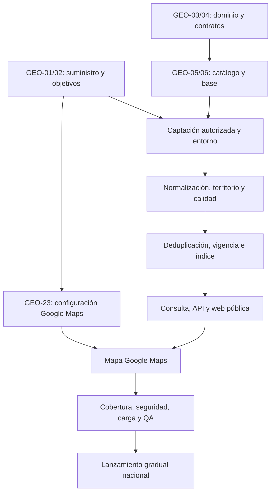

# GeoEmpleo — Plan técnico y backlog nacional

Fecha: 14 de octubre de 2026, Europe/Madrid. Plan y backlog con seguimiento de la primera implementación local.

Referencias: [contexto](../project-context.md), [arquitectura](../architecture/2026-10-14-geoempleo-arquitectura.md) y [primera iteración ejecutable](../superpowers/plans/2026-10-14-contratos-dominio.md).

## 1. Alcance y orden de decisiones

Requisitos confirmados: España, español, lanzamiento nacional de gran volumen, cobertura urbana/rural y todos los niveles profesionales, arquitectura multi-país, mapa Google Maps y **ningún registro/login/cuenta de candidato, tampoco opcional**.

La planificación se divide en subsistemas. El backlog describe resultados comprobables; solo la primera iteración tiene instrucciones de código completas. Los siguientes planes se redactarán cuando sus contratos y muestras estén disponibles. No ejecutar un backlog como si fuera un plan de implementación detallado.

| Decisión | Estado y siguiente evidencia |
|---|---|
| Acceso público sin cuenta | Confirmado; incluir prueba anónima en cada entrega de UI/API |
| Google Maps para visualizar | Confirmado; proyecto, claves, presupuesto y configuración aún sin crear |
| API modular y captación aislada | Propuesta seleccionada para planificar; verificar con prototipo de contratos |
| PostgreSQL/PostGIS + OpenSearch | Propuesta; benchmark con datos y consultas representativos antes de capacidad final |
| Monorepo por responsabilidad | Propuesta; dominio sin dependencias de cloud, HTTP ni UI |
| Python para captación, TypeScript para dominio | Propuesta; Python entrega eventos JSON validados, normalizador TS reutiliza las reglas del dominio |
| Proveedor cloud y gasto máximo | Pendiente; ninguna contratación o despliegue está autorizado por esta entrega |
| Fuentes nacionales completas | Pendiente; no existen credenciales/acuerdos probados para GeoEmpleo |

El normalizador TS será un worker independiente de la API. Python extrae datos y evidencia; los contratos JSON y fixtures comunes evitan implementar dos veces las reglas salariales/regionales.

## 2. Estructura prevista y límites

Estas rutas son propuestas para crear durante implementación; **no existen actualmente**.

```text
apps/web/                 Next.js: búsqueda, detalle y adaptador Google Maps
apps/api/                 NestJS: endpoints públicos de solo lectura
apps/normalizer/          Worker TS: reglas del dominio y persistencia
apps/indexer/             Worker TS: proyección OpenSearch
services/ingestion/       Python: adaptadores y planificación de captaciones
packages/domain/         Entidades y reglas independientes de framework
packages/country-es/     Políticas y catálogos de España
packages/contracts/      OpenAPI, JSON Schema y fixtures interoperables
packages/search/         Contratos y construcción tipada de consultas
infra/                   Contenedores, infraestructura y configuración por entorno
tests/                   Contratos, integración, E2E y escenarios de carga
docs/                    Contexto, decisiones, planes y runbooks
```

No crear todo este árbol de una vez. Cada tarea introduce únicamente sus archivos y dependencias necesarias. El paquete `domain` no importa NestJS, React, Google, ORM ni clientes de búsqueda.

## 3. Prioridades y dependencias del backlog

P0: condición necesaria de suministro, integridad o acceso público. P1: necesario para lanzamiento nacional. P2: evolución posterior. **GEO-03 está implementado localmente; GEO-04 está parcial (seis esquemas, validadores TS/Python y tres rutas GET descritas); GEO-06 está parcial, con tooling local.** GEO-04 aún necesita sugerencias, catálogos y contratos canónicos; no existe API HTTP. Los demás ítems están planificados, no iniciados. Los IDs son locales; no se han creado tareas en sistemas externos.

### Viabilidad y base

| ID / prioridad | Trabajo y responsable funcional | Depende de | Criterio de aceptación |
|---|---|---|---|
| GEO-01 P0 | Inventario y derechos de fuentes · Producto/datos | — | Matriz por territorio y familia: dueño, acceso, licencia, contenido completo, cuota, caducidad; ningún candidato se declara conectado sin evidencia |
| GEO-02 P0 | Objetivos de carga, calidad y presupuesto · Tech lead/plataforma | GEO-01 | Ratificar o corregir hipótesis de 1M activas/500 req/s; presupuesto por servicio, muestra QA y umbrales de cobertura acordados |
| GEO-03 P0 | Contratos de dominio y política España · Backend | — | Pruebas de salario/publicación y segundo país sintético sin editar núcleo; corresponde al plan de primera iteración |
| GEO-04 P0 | Contratos de eventos y API · Backend/datos | GEO-03 | JSON Schema/OpenAPI versionados; mismos fixtures aceptados/rechazados por TS y Python; datos desconocidos preservados |
| GEO-05 P0 | Persistencia canónica y outbox · Backend | GEO-03,04 | Migraciones con vacante/publicación/procedencia; ID único por fuente; eventos en misma transacción; restauración de backup en entorno de prueba |
| GEO-06 P0 | CI y entorno local · Plataforma | GEO-03 | Instalación reproducible por lockfile; checks de tipos/contratos; servicios locales y secretos de ejemplo sin valores reales; comandos documentados |

### Datos y captación

| ID / prioridad | Trabajo y responsable funcional | Depende de | Criterio de aceptación |
|---|---|---|---|
| GEO-07 P0 | Scheduler, cola y archivo · Datos/plataforma | GEO-01,04,06 | Cuotas/concurrencia por fuente; hash/evidencia autorizada; DLQ y reintentos 429; un lote incompleto no elimina ofertas |
| GEO-08 P0 | Conector oficial representativo · Datos | GEO-01,07 | Muestras oficiales trazables; distinguir vacante/bolsa/convocatoria; plazos y bases contrastados; permiso de reproducción comprobado |
| GEO-09 P0 | Conector privado representativo · Datos | GEO-01,07 | Acceso concedido, cuotas registradas, atribución y detalle completo permitido; no incluir perfiles ni CV |
| GEO-10 P0 | Conector rural/local representativo · Datos | GEO-01,07 | Ubicación y requisitos explícitos; no inventar alojamiento; parser validado con muestras rurales y mecanismo de retirada |
| GEO-11 P0 | Normalizador y procedencia · Backend/datos | GEO-04,05,07 | Worker TS valida eventos, registra política/parser y origen por campo; formato inválido a cuarentena; desconocidos no inventados |
| GEO-12 P1 | Territorio y geocodificación · Datos | GEO-01,04,11 | Códigos y vigencia oficiales verificados; Ceuta/Melilla/Canarias; topónimos/CP ambiguos; coordenadas con precisión y derechos de persistencia |
| GEO-13 P1 | Taxonomía y perfiles · Datos/producto | GEO-04,11 | ESCO/CNO versionados; ocupación, experiencia y formación independientes; evaluación humana por familia incluida rural/operativa/directiva |
| GEO-14 P0 | Deduplicación reversible · Backend/datos | GEO-05,11 | Corpus con positivos/negativos; no fusionar turnos/centros/puestos distintos; conservar publicaciones y revertir merges |
| GEO-15 P0 | Caducidad y reconciliación · Backend/datos | GEO-07,11,14 | Snapshot completo, tombstone, caída de fuente y expiración; vacante activa si existe soporte vigente; reingesta no altera fecha original |

### Búsqueda y producto público

| ID / prioridad | Trabajo y responsable funcional | Depende de | Criterio de aceptación |
|---|---|---|---|
| GEO-16 P0 | Proyección e indexador · Backend | GEO-05,11,14,15 | Outbox idempotente y versionado; recuperación de DLQ; reconstrucción/alias; mismo número de vacantes activas elegibles, con discrepancias explicadas |
| GEO-17 P0 | Consulta y facetas · Backend | GEO-12,13,16 | AND/OR documentado; salario comparable; remoto por elegibilidad; facetas y resultados comparten filtros/permisos |
| GEO-18 P1 | Cursor y clusters · Backend | GEO-17 | PIT + orden estable; cursor vinculado a filtros y TTL; mapa limitado por bbox/zoom; cierres no reaparecen por PIT antiguo |
| GEO-19 P0 | API pública y detalle · Backend | GEO-05,15,17 | Sin auth de candidato; descripción completa, origen y inscripción externa; errores del buscador no equivalen a cero ofertas; contenido saneado |
| GEO-20 P0 | Web de consulta y detalle · Frontend | GEO-04,19 | Español, URLs compartibles, SSR de detalle; filtros móviles; estado vacío/error; ningún control o ruta redirige a login |
| GEO-21 P1 | Google Maps y aislamiento de UI · Frontend/plataforma | GEO-12,18,20,23 | Dynamic bajo demanda y reutilizado; markers/clusters propios y selección de lista; admisión conservadora distribuida durante el mes; Embed básico si no queda capacidad; error conserva lista/detalle |
| GEO-22 P1 | SEO y accesibilidad · Frontend/QA | GEO-20,21 | Teclado/lector de pantalla; alternativa al mapa; canónicas/sitemap; schema adecuado por tipo de oportunidad y retirada al caducar |

### Operación y lanzamiento

| ID / prioridad | Trabajo y responsable funcional | Depende de | Criterio de aceptación |
|---|---|---|---|
| GEO-23 P1 | Proyecto/configuración de Google Maps · Plataforma | GEO-02 | APIs mínimas, clave web por sitios/API y entorno, clave servidor separada si procede; objetivo inicial Maps 0 €; tramo Dynamic 10.000/mes compartido por cuenta; Embed gratuito ilimitado de continuidad, claves por API; control probado antes de activar Dynamic, sin prometer tope de gasto por alertas; condiciones EEE; sin login |
| GEO-24 P0 | Seguridad y políticas de publicación · Backend/QA | GEO-07,19,20 | XSS/SSRF/redirecciones probados; contenido retirado por permiso revocado; logs sin datos personales/ubicación precisa; acceso operativo separado |
| GEO-25 P1 | Infraestructura y observabilidad · Plataforma | GEO-02,06,07,16 | Entornos aislados, despliegue reversible, métricas por fuente y cola, disponibilidad/latencia, presupuesto y alertas accionables |
| GEO-26 P1 | Calidad/cobertura nacional · Datos/QA | GEO-08,09,10,12,13,14,15 | Matriz de CCAA/ciudades autónomas y perfiles con muestras; huecos registrados; umbrales acordados en GEO-02 cumplidos o lanzamiento replanificado |
| GEO-27 P1 | Carga y recuperación · Plataforma/QA | GEO-18,19,21,25 | p95 API ≤400 ms en carga acordada; caché fría/caliente y ráfagas; restauración RPO/RTO medida; despliegue/reindexado sin pérdida |
| GEO-28 P0 | QA pública de extremo a extremo · QA | GEO-20,21,22,24 | Contexto limpio sin cuenta/cookies; mapa/lista/detalle; externo con registro advertido; fallos de SDK/API y geolocalización denegada |
| GEO-29 P1 | Lanzamiento gradual nacional · Producto/plataforma | GEO-23,25,26,27,28 | Evidencias de salida, runbooks, soporte, rollback y métricas de frescura; catálogo público completo autorizado; sin invitaciones ni registro |
| GEO-30 P2 | Segundo país real · Backend/datos | GEO-29 | Nuevo paquete/fuentes/idioma y contratos; no introducir condicionales de país en núcleo; benchmark y derechos específicos |
| GEO-31 P2 | Tiempo de desplazamiento · Producto/backend | GEO-21,29 | Necesidad de Routes/transporte demostrada; cuota/coste/condiciones aceptados; radio nunca se presenta como tiempo de viaje |

## 4. Secuencia y criterios de salida



Camino crítico: acceso y permisos de fuentes → datos completos → catálogo vigente → índice → experiencia pública → cobertura/QA → lanzamiento. Los contratos pueden avanzar con fixtures propios mientras se negocian fuentes. Ninguna maqueta con datos de ejemplo acredita cobertura nacional.

| Hito | Condición de salida y evidencia |
|---|---|
| H0 Viabilidad | GEO-01/02: suministro autorizado viable, presupuesto y cobertura definidos |
| H1 Dominio/base | GEO-03–06: tests, contratos y persistencia reproducibles |
| H2 Catálogo utilizable | GEO-07–15: oficiales/privadas/rurales, procedencia y vigencia medidas |
| H3 Búsqueda pública | GEO-16–23: navegación anónima completa y Google Maps integrado |
| H4 Preparación nacional | GEO-24–28: seguridad, cobertura, carga y restauración demostradas |
| H5 Lanzamiento | GEO-29: operación y rollback preparados, métricas públicas monitorizadas |

La estimación global de arquitectura, 20–28 semanas para el equipo indicado, se conserva como orientación. No sumar duraciones de ítems: hay dependencias y solapamientos. El primer plan cubre GEO-03 y la base mínima de tooling; no entrega H1 completo.

## 5. Integración concreta de Google Maps

Contrato de UI propio: `MapViewport {west,south,east,north,zoom}` y respuestas `marker`/`cluster` con posición, cantidad y referencia de vacante. Objetos del SDK solo dentro de `apps/web/src/features/map/google-map-adapter.ts`; estado de consulta y filtros en módulos independientes.

Archivos previstos para GEO-21: `google-map-adapter.ts`, `load-google-maps.ts`, `JobMap.tsx`, `map-contract.ts` y `tests/e2e/public-map.spec.ts`. Crear carga singleton, timeout y limpieza de listeners. Al terminar movimiento del mapa, aplicar debounce de 300 ms y cancelar peticiones anteriores; no convertir cada evento de arrastre en consulta.

Renderizar una instancia por montaje; los cambios de filtros actualizan datos. Los clusters vienen del endpoint de GeoEmpleo, con límites de densidad/respuesta. Mantener oferta seleccionada vinculada por ID a listado/detalle. Para ubicaciones aproximadas, mostrar municipio y precisión; no un supuesto domicilio exacto.

Configurar SDK en español y región España para la primera versión; el paquete de país determina esas opciones en extensiones. Una cuenta Google no es necesaria para los visitantes de GeoEmpleo. El proyecto/credenciales son técnicos y no forman parte del flujo de usuario.

Facturación y cargas se gestionan a nivel de proyecto; Places/Routes y demás servicios son independientes. No fijar precios ni créditos históricos. Reducir cargas innecesarias, medir sesiones con mapa y estimar gasto desde el SKU vigente. [Uso y facturación de Maps JavaScript](https://developers.google.com/maps/documentation/javascript/usage-and-billing).

Restringir claves por sitio/API y separar entornos/backend. No se puede tratar la clave web como secreto oculto; su defensa son restricciones y vigilancia. [Guía de seguridad](https://developers.google.com/maps/api-security-best-practices).

Los datos del catálogo requieren licencia de persistencia. No extraer geometrías de Google Maps ni convertir respuestas Geocoding/Places en una base permanente sin verificar condiciones. Revisar régimen EEE según dirección de facturación. [Geocoding: políticas](https://developers.google.com/maps/documentation/geocoding/policies), [Maps JavaScript: políticas](https://developers.google.com/maps/documentation/javascript/policies).

QA específica: ausencia de clave, clave restringida incorrectamente, cuota agotada, timeout, script bloqueado, red lenta, móvil, navegación por teclado y denegación de geolocalización. En todos los fallos técnicos del mapa, la consulta textual y el detalle siguen utilizables.

## 6. Definición de preparado y terminado

Un ítem está preparado cuando tiene responsable, dependencias satisfechas, contratos/versiones, muestras permitidas, criterios de aceptación y comandos/pruebas concretos en su plan. Los adaptadores reales exigen acceso concedido; GEO-21 exige configuración técnica de Google Maps disponible.

Un ítem termina con evidencia reciente: cambios acotados, checks pertinentes, migración/rollback si existe, contrato compatible, métricas cuando aplique y contexto actualizado. No declarar test E2E real a partir de mocks, ni integración de Google Maps a partir de un contenedor visual vacío.

La primera iteración no necesita permisos de fuentes ni Google: prueba reglas con fixtures propios. La siguiente iteración preparará los contratos interoperables y persistencia antes de construir la búsqueda. El mapa se integra sobre ese flujo para evitar una UI que no corresponda al catálogo.

## Evidencia local actual

GEO-04 parcial: JSON Schema 2020-12, Ajv/WHATWG y Python/jsonschema/Ada, OpenAPI 3.1 empaquetado. `npm run check`: 102 tests Node y 76 fixtures Python correctos, tipos estrictos y generación API sincronizada. Plan y corpus en `docs/superpowers/plans/2026-10-14-contratos-v1.md` y `packages/contracts/fixtures/v1.json`. No hay servidor, ingesta, base de datos ni UI; H1 sigue incompleto.

La [decisión de mapas y coste](../architecture/2026-10-14-google-maps-coste.md) prioriza similitud a Bandana y bajo gasto, diferenciando Dynamic avanzado y Embed básico. Solo Embed permite continuidad de mapa sin límite de cargas publicado y sin consumir el tramo Dynamic; pierde clusters propios. Configuración cloud y control de consumo siguen pendientes.
